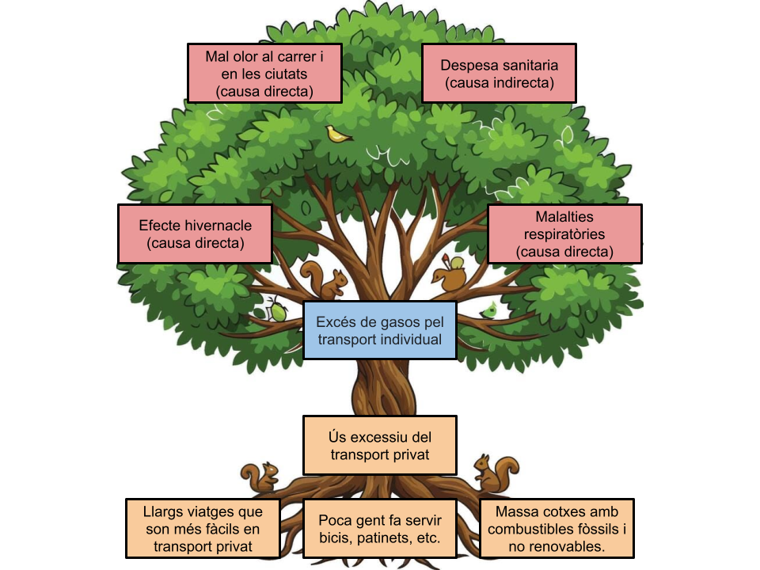

# Activitat 1.4.

## Noms i rols de l'equip:
- Dylan Santamaria Morales
- Gael Garvin
- Jose Luque

Hem creat un Google Drawings en drive compartit entre nosaltres, on hem dissenyat l'arbre i ho hem fet entre tots. Després el Dylan ho ha passat al GitHub tant l'arbre fet com les idees de les respostes ben escrites.

## Part 2:

### Causes:
- Causes directes: Ús excessiu del transport privat / Massa cotxes amb combustibles fòssils i no renovables.
- Causes indirectes: Poca gent fa servir bicis, patinets, etc. / Llargs viatges que son més fàcils en transport privat

### Conseqüències:
- Conseqüències ambientals: Efecte hivernacle (causa directa) / Mal olor al carrer i  en les ciutats (causa directa) / 
- Conseqüències socials: Malalties respiratòries (causa directa)
- Conseqüències econòmiques: Despesa sanitaria (causa indirecta)

## Fonts d'informació:
- https://es.greenpeace.org/es/trabajamos-en/cambio-climatico/movilidad/
- https://www.who.int/es/news-room/fact-sheets/detail/ambient-(outdoor)-air-quality-and-health
- https://www.miteco.gob.es/es/cambio-climatico/temas/mitigacion-politicas-y-medidas/transporte.html
- https://coches.idae.es/consumo-de-carburante-y-emisiones
